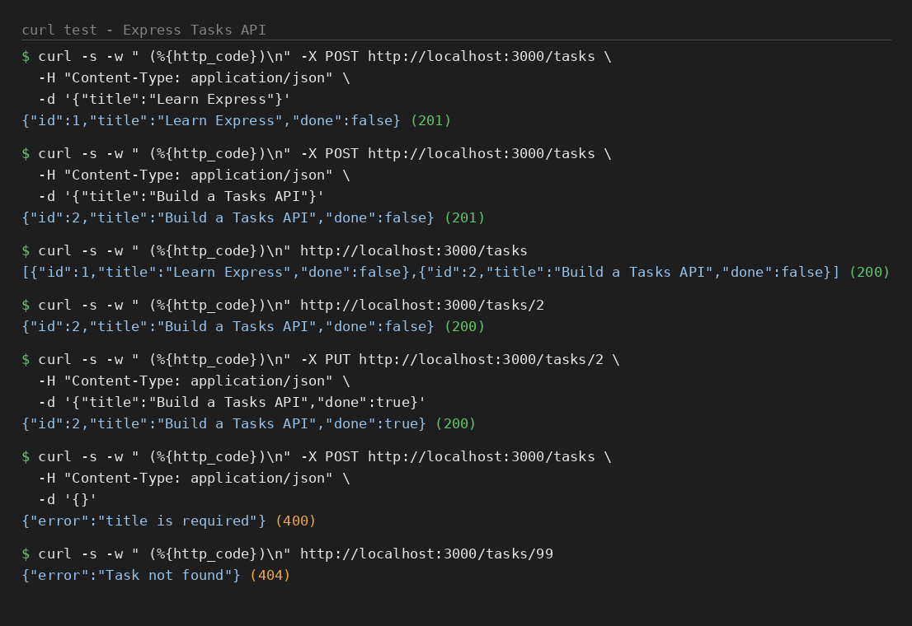

# Express Tasks API

A small practice project for Express and REST APIs. It keeps tasks in memory and supports adding, listing, reading one and updating a task, with validation.

Tasks only live in memory, so restarting the server clears them. There is no login and no database.

## Run it

```bash
git clone https://github.com/JFJubayer/express-tasks-api.git
cd express-tasks-api
npm install
npm start
```

The API runs at `http://localhost:3000`. Use `PORT=4000 npm start` for another port. Needs Node.js 20 or newer (tested on Node 22).

## Endpoints

| Method | Endpoint | What it does | Success | Errors |
| --- | --- | --- | --- | --- |
| `POST` | `/tasks` | Add a task. Body: `title` (required), `done` (optional, default `false`) | `201` | `400` invalid body |
| `GET` | `/tasks` | List all tasks | `200` | |
| `GET` | `/tasks/:id` | Get one task | `200` | `404` not found |
| `PUT` | `/tasks/:id` | Update a task. Send `title` (required) and `done` (becomes `false` if left out) | `200` | `400` invalid body, `404` not found |

A task looks like `{ "id": 1, "title": "Learn Express", "done": false }`.

### Validation

- `title` must be a non-empty string, otherwise the API answers `400` with `{ "error": "title is required" }`
- `done`, when sent, must be `true` or `false`
- Broken JSON answers `400` with `{ "error": "Invalid JSON" }`
- Send the header `Content-Type: application/json` with every request that has a body

## Try it with curl

```bash
curl -s -w " (%{http_code})\n" -X POST http://localhost:3000/tasks \
  -H "Content-Type: application/json" \
  -d '{"title":"Learn Express"}'

curl -s -w " (%{http_code})\n" -X POST http://localhost:3000/tasks \
  -H "Content-Type: application/json" \
  -d '{"title":"Build a Tasks API"}'

curl -s -w " (%{http_code})\n" http://localhost:3000/tasks

curl -s -w " (%{http_code})\n" http://localhost:3000/tasks/2

curl -s -w " (%{http_code})\n" -X PUT http://localhost:3000/tasks/2 \
  -H "Content-Type: application/json" \
  -d '{"title":"Build a Tasks API","done":true}'

curl -s -w " (%{http_code})\n" -X POST http://localhost:3000/tasks \
  -H "Content-Type: application/json" \
  -d '{}'

curl -s -w " (%{http_code})\n" http://localhost:3000/tasks/99
```

`-w " (%{http_code})\n"` prints the HTTP status code after each response. Output of a real run on a fresh server (the last two commands show the `400` and `404` errors):



## Tests

```bash
npm test
```

## Project structure

```text
src/app.js         routes and validation
src/server.js      starts the server
test/api.test.js   automated tests
docs/curl-test.png curl test output
```
